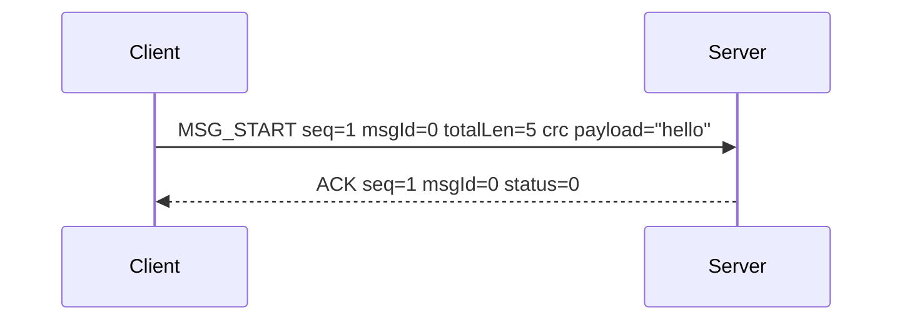
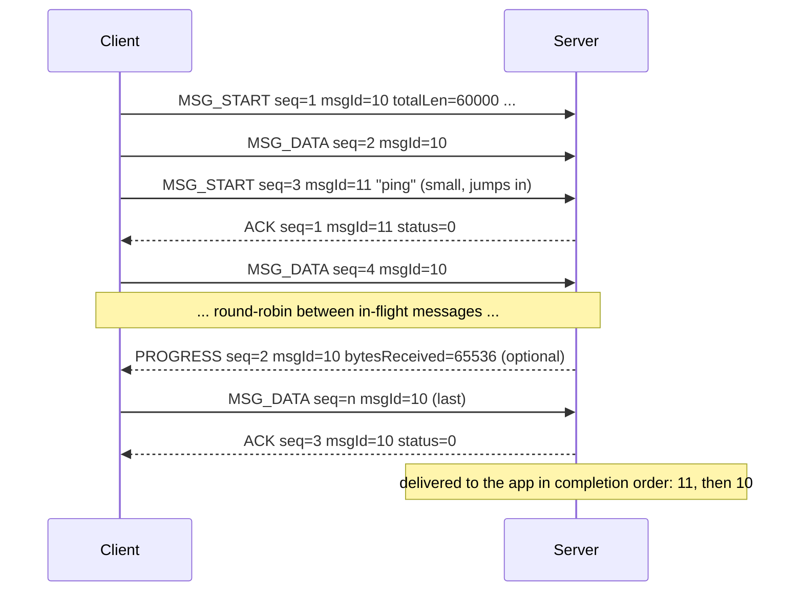
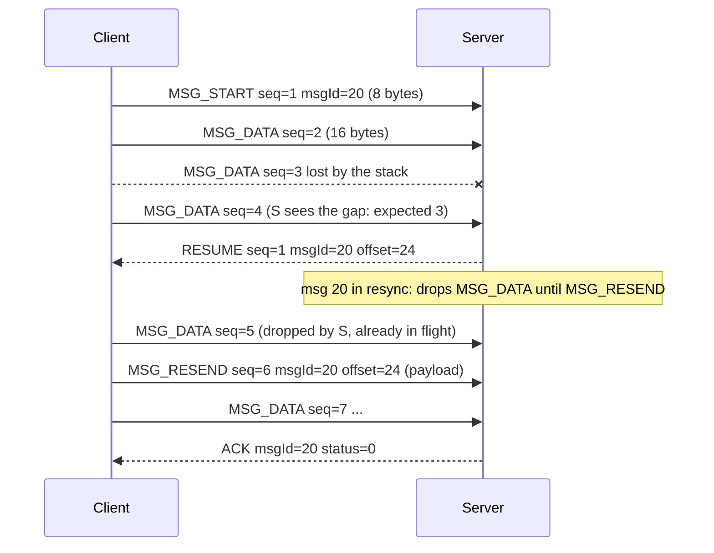
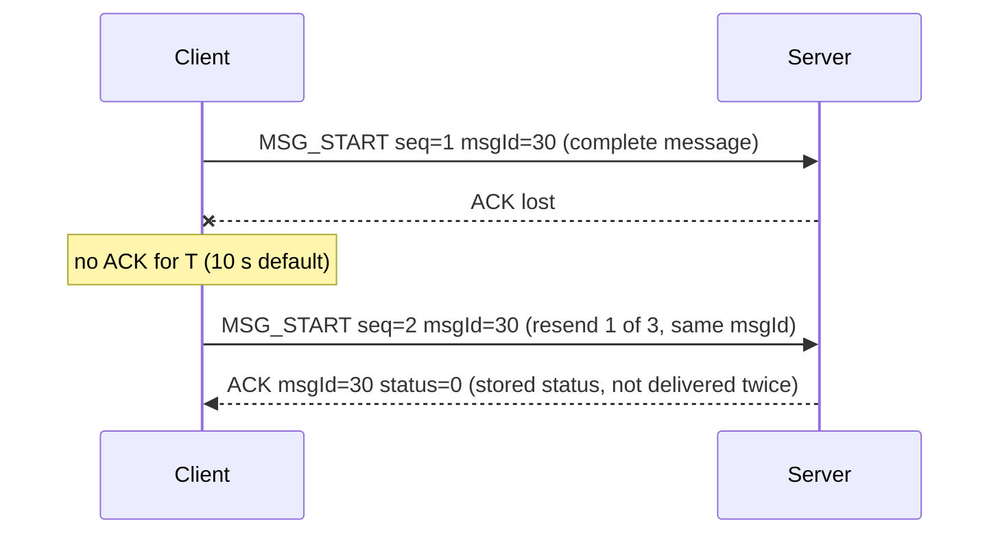

# BleLink message protocol, version 1

Status: normative spec for protocol v1. The key words MUST, SHOULD and MAY are used as in RFC 2119.
Companion file: `docs/protocol-test-vectors.json` (generated by `scripts/gen_protocol_vectors.py`; every
implementation MUST reproduce those bytes).

BleLink carries **messages of any size** (0 bytes to the negotiated maximum, up to 4 GiB - 1) in both
directions between a **server** (GATT peripheral; the Unity desktop app on Windows, Linux or macOS)
and a **client** (GATT central: iOS, Android, microcontrollers, Web Bluetooth, desktop). It runs on three
GATT characteristics, needs no L2CAP channel, and can be implemented in C99 with static buffers.

All multi-byte integers are **little-endian**. All sizes are in bytes.

## 1. GATT service

Base UUID `7b1e1000-5a6c-4f0e-9d3b-2c1a8e4f6b01`. Characteristic UUIDs replace the 16-bit field `1000`.

| Name | UUID | Properties | Direction | Content |
|------|------|-----------|-----------|---------|
| Service | `7b1e1000-5a6c-4f0e-9d3b-2c1a8e4f6b01` | | | primary service, advertised |
| RX | `7b1e1001-5a6c-4f0e-9d3b-2c1a8e4f6b01` | Write, Write Without Response | client -> server | one packet per write |
| TX | `7b1e1002-5a6c-4f0e-9d3b-2c1a8e4f6b01` | Notify (CCCD) | server -> client | one packet per notification |
| INFO | `7b1e1003-5a6c-4f0e-9d3b-2c1a8e4f6b01` | Read | server -> client | 10-byte server limits (section 4.1 body) |

Rules:

- Every write and every notification carries **exactly one packet**. Packets never span writes; the protocol never
  uses Long Write, Prepare Write, or Indications.
- The client MUST enable notifications on TX (write CCCD) before sending HELLO.
- Writes MAY use either write type. Write Without Response is RECOMMENDED for data (throughput);
  Write With Response MAY be used by platforms that cannot do otherwise (for example Web Bluetooth).
  HELLO SHOULD use Write With Response so the client learns that it was accepted.
- INFO is for discovery and debugging only (a client can read the server's limits before connecting a session);
  it does not replace HELLO. Layout: the HELLO body (section 4.1) without `type` and `seq`
  (`version, maxPacket, maxMessage, window, flags, timeout`).
- Pairing, bonding and encryption are **GATT permissions** (section 13), not part of this protocol.

## 2. Packets

### 2.1 Common header

```
offset size field
0      1    type   packet type
1      1    seq    per-direction packet counter, mod 256
```

`seq`: each side keeps one counter per session and direction. HELLO has `seq = 0`; every following packet sent by the
same side increments it by 1 (mod 256, wraps 255 -> 0). Every packet type, including ACK, counts.
A receiver tracks `expectedSeq`; if `seq != expectedSeq` then `(seq - expectedSeq) mod 256` packets were dropped by
a stack on the way (see section 8), and `expectedSeq := seq + 1`.

### 2.2 Packet size

`packetSize` is the maximum number of bytes in one packet (header included), per direction (section 5).
It MUST be at least 20 (ATT_MTU 23 minus 3) and at most 512 (ATT attribute value limit). Every packet type below fits
in 20 bytes except for the data-carrying types, which carry `packetSize - header` payload bytes.

### 2.3 Packet types

| Type | Name | Sent by | Size | Layout after the header |
|------|------|---------|------|-------------------------|
| 0x01 | HELLO | both | 12 | `version u8, maxPacket u16, maxMessage u32, window u8, flags u8, timeout u8` |
| 0x02 | MSG_START | sender | 12 + n | `msgId u16, totalLen u32, crc32 u32, payload[n]` |
| 0x03 | MSG_DATA | sender | 4 + n | `msgId u16, payload[n]` |
| 0x04 | ACK | receiver | 5 | `msgId u16, status u8` |
| 0x05 | RESUME | receiver | 8 | `msgId u16, offset u32` |
| 0x06 | CANCEL | sender | 5 | `msgId u16, reason u8` |
| 0x07 | PROGRESS | receiver | 8 | `msgId u16, bytesReceived u32` |
| 0x08 | MSG_RESEND | sender | 8 + n | `msgId u16, offset u32, payload[n]` |

"Sender" and "receiver" are per message, not per role: **both** server and client can send and receive messages
simultaneously. Each direction has its own msgId space, seq counter and limits.

Payload capacity per packet: MSG_START `packetSize - 12`, MSG_DATA `packetSize - 4`, MSG_RESEND `packetSize - 8`.
At packetSize 20 that is 8, 16 and 12 bytes. `n` MAY be smaller than the capacity in the last packet of a message
and SHOULD be > 0 for MSG_DATA/MSG_RESEND. Senders SHOULD fill packets to capacity except the last one of a message.

Receivers MUST accept `n` anywhere from 0 up to the capacity; they MUST NOT assume packets are full.

Forward compatibility: a packet with an **unknown type** MUST be ignored (but its seq still counts). A packet
that is shorter than its fixed layout MUST be ignored. Trailing bytes after a fixed-size packet (HELLO, ACK, RESUME,
CANCEL, PROGRESS) MUST be ignored, so later versions can append fields.

### 2.4 Message framing

A message is an opaque byte string `M` of length `totalLen`. The sender picks a `msgId` (section 7) and sends

```
MSG_START(msgId, totalLen, crc32(M), M[0 : startCap])
MSG_DATA (msgId, M[startCap : startCap+dataCap])
MSG_DATA (msgId, ...)
...
```

in offset order. A message that fits in `startCap` bytes is a single MSG_START packet. `totalLen = 0` is a legal
empty message (crc32 = 0, one MSG_START with no payload).

`crc32` is **CRC-32/IEEE 802.3** (the zlib / PNG / Ethernet CRC): reflected, polynomial `0xEDB88320`, initial value
`0xFFFFFFFF`, final XOR `0xFFFFFFFF`. Check: `crc32("123456789") = 0xCBF43926`. It covers the whole message
payload `M` only (not headers). It is computed over the data as a running value, so a streaming receiver updates
it per packet and compares at the end. A sender that cannot know the CRC up front (generated stream) is out of
scope for v1; it must buffer or pre-compute (see decision D6).

## 3. Roles and sessions

A **session** exists per (server, connected central). The server keeps one independent session per connected
central (own seq counters, limits, messages) and sends only to the specific central. There is no broadcast.

Session states (each side):

```
          connect          CCCD enabled           HELLO sent (client)
 CLOSED ----------> LINKED ---------------> OPENING ---------------> READY
    ^                                          |  HELLO recv'd              |
    |                                          +  (server answers)---------> |
    +------------------ disconnect / version mismatch / fatal ------------- +
```

- LINKED: connected, TX notifications not yet enabled. The server MUST ignore RX writes of any type but HELLO.
- OPENING: the client sends HELLO as the first packet; the server replies HELLO as soon as it receives the
  client's. The session is READY on each side once it has **both sent and received** a HELLO.
- READY: messages may flow, in both directions at once, up to the peer's advertised limits.
- Any packet other than HELLO received before READY MUST be ignored (and its seq counted).
- A HELLO received while READY **resets the session**: both sides drop all in-flight messages (sender side:
  fail with `reset`; receiver side: discard partial messages, no ACK), clear their duplicate memory, set
  `expectedSeq := 1` and restart the seq counter after HELLO. The side that did not initiate the reset answers
  with its own HELLO (once per received HELLO). Either side MAY send HELLO to reset; typical uses: the client
  re-sends HELLO after the MTU changed, or after an app restart that kept the connection.
- Disconnect (any cause) -> CLOSED. All in-flight messages fail with `disconnected`.

## 4. HELLO and limits

### 4.1 HELLO

```
type=0x01 seq=0 | version u8 | maxPacket u16 | maxMessage u32 | window u8 | flags u8 | timeout u8      (12 bytes)
```

Every field describes the **sender of the HELLO as a receiver** (its receive-side limits):

- `version`: highest protocol version the sender speaks. v1 = 1. (section 12)
- `maxPacket`: largest packet (header included) the sender can receive in one write/notification.
  MUST be in 20..512; a lower value MUST be treated as 20, a higher one as 512.
- `maxMessage`: largest `totalLen` the sender accepts. MAY be tiny (for example 4096 on a microcontroller)
  or large (default of the Unity server: 16 MiB = 16777216). `0xFFFFFFFF` means "no limit".
- `window`: maximum number of messages the sender accepts **concurrently** (incomplete or not yet ACKed by
  the peer's counting, see 6.2). MUST be >= 1. Microcontrollers with one receive buffer use 1. Default 4.
- `flags`: bit 0 = PROGRESS supported (the sender of HELLO wants PROGRESS packets for messages it sends, and
  can itself send them); bit 1 = streaming receiver (informational: the receiver hands data to the application
  while the message is incomplete, section 9); bits 2..7 reserved, MUST be 0 on send and ignored on receive.
- `timeout`: the idle timeout this side needs, in units of 0.25 s; `0` = the default 40 (10 s). See 10.

The first HELLO is sent by the client; the server answers with its own HELLO on TX. HELLO MUST fit in
20 bytes (it does: 12). A HELLO uses seq 0 and resets the per-direction counter.

### 4.2 What each side derives

For messages that side A sends to side B, A MUST obey B's HELLO:

- `maxMessage_B`: A MUST NOT start a message longer than this. (B would reject it with ACK status 2 anyway.)
- `window_B`: A MUST NOT have more than this many of its messages in flight (started and not yet ACKed).
- `packetSize` for A -> B packets: `min(maxPacket_B, A's OS-reported maximum payload per write/notification)`,
  clamped to 20..512 (section 5).
- Timeout: `T = max(timeout_A, timeout_B)` (after replacing 0 with 40), applied to both directions (section 10).

## 5. Packet size negotiation

There is no separate negotiation packet. Each side computes the packet size it **sends** with:

```
packetSize(A -> B) = clamp( min(maxPacket_B, osLimit_A), 20, 512 )
```

`osLimit_A` is what A's stack allows for one unconfirmed write or notification = `ATT_MTU - 3`.
Before HELLO completes, `packetSize = 20`. HELLO packets are always <= 20 bytes.

| Platform | How to obtain osLimit |
|----------|-----------------------|
| Android central | `requestMtu(517)` -> `onMtuChanged(mtu)` -> `mtu - 3` |
| iOS/macOS central | `peripheral.maximumWriteValueLength(for: .withoutResponse)` (already minus 3) |
| Zephyr / nRF Connect | `bt_gatt_get_mtu(conn) - 3` (after `bt_gatt_exchange_mtu`) |
| ESP32 NimBLE | `ble_att_mtu(conn_handle) - 3` (after `ble_gattc_exchange_mtu`) |
| Web Bluetooth | not exposed: use 20 (or a conservative 182 if you know your target); no way to read the MTU |
| macOS/iOS peripheral (server) | `CBCentral.maximumUpdateValueLength` |
| Windows server | `GattSession.MaxPduSize - 3` |
| BlueZ server | characteristic `MTU` property of the acquired notify fd (`AcquireNotify`) |

Both directions are independent: the server may send 244-byte notifications while a client with a smaller write
limit sends 182-byte writes.
If the MTU changes later (some stacks renegotiate), a side MAY re-send HELLO (reset) or simply continue with the old,
smaller `packetSize`; it MUST NOT send packets larger than the current OS limit.
A receiver MUST be able to accept any packet up to its advertised `maxPacket`.

## 6. Messages, flow control and ACKs

### 6.1 Link-layer assumptions

A BLE connection retransmits at the link layer, so packets are not lost during a normal connection. Loss happens
only (a) when a stack queue overflows because the sender ignored backpressure, (b) on disconnect, and (c) through
stack bugs. The protocol therefore uses **no per-packet ACKs**: it uses OS flow control to prevent loss, `seq` to detect
loss, `RESUME` to repair it, and one ACK per message.

### 6.2 Sender flow control (MUST)

The sender MUST NOT write when the stack signals it is not ready; it MUST wait for the platform signal:

| Sender | Signal |
|--------|--------|
| macOS/iOS peripheral (notify) | `updateValue` returned false -> wait `peripheralManagerIsReady(toUpdateSubscribers:)` |
| iOS/macOS central (write w/o response) | `peripheral.canSendWriteWithoutResponse`, then `peripheralIsReady(toSendWriteWithoutResponse:)` |
| Android central | next write only after `onCharacteristicWrite` (one outstanding GATT operation) |
| Android peripheral (notify) | next notify only after `onNotificationSent` |
| Windows server | `await` the previous `NotifyValueAsync` |
| BlueZ server | write to the notify fd blocks / returns EAGAIN: wait for writability (`POLLOUT`) |
| Zephyr | `bt_gatt_write_without_response_cb` callback / `bt_gatt_notify_cb` done-callback; or block on a semaphore |
| ESP32 NimBLE | `ble_gattc_write_no_rsp_flat` returns `BLE_HS_ENOMEM`: wait and retry |

In addition, the receiver's `window` bounds the number of messages in flight.

### 6.3 Messages in flight, ACK

A message is **in flight** from the first packet sent until its ACK arrives (or it fails). A sender MUST NOT have
more than `window_peer` messages in flight. A receiver MUST process a MSG_START that would exceed its `window`
as "no memory": reply ACK status 3 and ignore the message (its following MSG_DATA are ignored, see below).

The receiver sends **one ACK** when a message is complete and verified (or rejected):

| Status | Meaning | Sender behaviour |
|--------|---------|------------------|
| 0 | OK: all `totalLen` bytes received, CRC matched, handed to the application | message done |
| 1 | CRC mismatch (whole message received, CRC wrong) | resend automatically, max 3 resends, then fail `crc` |
| 2 | too large (`totalLen > maxMessage`) | fail `too_large`, no retry |
| 3 | no memory / window exceeded / busy | fail `busy`; the app MAY retry later (backoff) |
| 4 | rejected by the application | fail `rejected`, no retry |
| 5..255 | reserved | treat like 4 |

An ACK with status != 0 MAY also be sent **before** the message is complete (after MSG_START for 2 and 3, or at any
time for 4); the sender MUST then stop sending the message. After such an ACK the receiver MUST silently ignore
further MSG_DATA/MSG_RESEND for that msgId and MUST NOT answer them with RESUME.

Duplicate handling: the receiver remembers the **last `window` completed msgIds with their statuses**. A MSG_START
for a remembered, completed msgId (a retry after a lost ACK) MUST NOT be delivered again: the receiver re-sends the
ACK with the stored status and ignores the message's packets. An implementation with no spare RAM (window = 1) keeps
one entry (4 bytes).

Receiver per-message state: `msgId, totalLen, crc (running), received bytes`. The receiver validates that `n`
bytes arriving would not exceed `totalLen`; if they would (corrupt sender) it fails the message with ACK status 1.

### 6.4 Ordering

- Within one message, packets arrive in offset order (GATT preserves order per characteristic). A receiver
  may rely on it (section 9).
- Between messages: messages are delivered to the application in **completion order** (the order in which
  their last byte, and CRC, were verified), not start order. Small messages overtake big ones by design.
- If the application needs send order, it either uses `window = 1`-style sequencing (send the next message after the
  previous ACK) or numbers its messages inside the payload. (Decision D4.)

## 7. Message ids

`msgId` is chosen by the **sender** and unique per direction. The sender increments a u16 counter per new message
(start value 0, wraps 65535 -> 0; the first id of a session is 0). An id MUST NOT be reused while the message is in
flight or while the receiver might still remember it: because `window <= 255` ids are in flight at most, and the
counter takes 65536 messages to wrap, the rule "assign ids in strictly increasing order mod 65536" is sufficient. A retry of a message after a
timeout uses the **same** msgId (so the receiver can de-duplicate); a retry after the application re-submits a
failed message gets a new id.

## 8. Loss detection and repair

### 8.1 Receiver detects a seq gap

When a receiver sees a seq gap it MUST, for **every message currently being received** (incomplete):

1. send `RESUME(msgId, offset)` where `offset` = the number of bytes of that message received so far
   (the next expected offset), and
2. set the message to **resync**: drop every MSG_DATA for it until a MSG_RESEND (or a restarting MSG_START) arrives.

Also, MSG_DATA/MSG_RESEND for a msgId the receiver does not know (its MSG_START was lost) -> send **once**
`RESUME(msgId, 0)` and ignore the packet; later packets for that id are ignored silently (no repeat RESUME until
a MSG_START for it arrives, or the idle timeout fires).

### 8.2 Sender reacts to RESUME

On `RESUME(msgId, offset)` for an in-flight message the sender restarts that message at `offset`:

- `offset = 0`: send MSG_START again (full restart, same msgId, same crc) and the data after it.
- `offset > 0`: send **MSG_RESEND(msgId, offset, payload)** with the bytes starting at `offset`, then MSG_DATA for
  the following bytes. (Reason: MSG_DATA carries no offset, so after a RESUME the receiver needs to
  recognise where the repaired stream starts and that the stale packets already in flight are over.)
- RESUME for an unknown, finished or aborted msgId: ignore.
- Several RESUME packets for the same message that arrive back to back (caused by one gap): the sender SHOULD restart
  only on the first and ignore later RESUMEs whose offset is <= the offset it already restarted at until
  the next packet it sends after restart. A sender MAY restart at most 8 times per message, then it fails with
  `link_unreliable` and sends CANCEL.
- A MSG_RESEND with `offset != received` for a known message: the receiver ignores the packet and sends RESUME
  (msgId, received) once (stay in resync).
- A MSG_START for a msgId that is currently being received **restarts** it (discard partial state, reset CRC;
  a streaming receiver must tolerate this and be able to discard what it already stored).

### 8.3 Lost ACK

If the ACK is lost, the sender's ack timeout fires (section 10) and it resends the whole message (MSG_START) with
the same msgId; the receiver answers with the remembered ACK (6.3).

### 8.4 Gap inside non-message packets

If the dropped packet was an ACK, PROGRESS, RESUME or CANCEL, the detecting side finds out through the seq
counter, but there is nothing to repair directly: ACK loss is handled by the sender's timeout, RESUME loss by the
receiver's idle timeout (it sends RESUME again), PROGRESS loss is harmless, CANCEL loss by the receiver's idle timeout
(it discards and sends RESUME which the sender ignores, since the message is aborted).

## 9. Streaming receive (microcontrollers)

Within a message, data arrives in offset order, so a receiver MAY process data while the message is incomplete,
with **no protocol difference**:

- It keeps `received` and a running CRC (4 bytes, table-less bitwise CRC32 needs ~40 bytes of code; a 256-entry
  table needs 1 KB, a 16-entry nibble table 64 bytes).
- It writes each payload to its sink (flash page buffer, UART, parser) as it arrives.
- On completion it compares the running CRC with the one in MSG_START. On mismatch it sends ACK status 1 and the
  application MUST discard what it consumed: data of an unverified message is **provisional**. An application
  that cannot undo side effects should buffer (and then it needs maxMessage <= its buffer), or use
  application-level commit (for example "swap the flash bank only after ACK OK was sent").
- It advertises `flags` bit 1 and a large `maxMessage` (flash size) with `window = 1`. A MSG_START
  for an id when one message is already in progress is answered with ACK status 3 (or restarts the current
  message if it has the same msgId).
- On a RESUME-triggered MSG_RESEND or a restarting MSG_START it continues at the right offset or restarts from
  zero; therefore the sink must support "rewind to offset" or restart: with `offset = received` a RESUME never
  asks for bytes that were consumed, because the receiver always asks for `received`, i.e. exactly the point where it stopped.
  Only a full restart (MSG_START again) requires discarding.

Sender side on an MCU: it needs a source it can read at an arbitrary offset (flash) or a buffer for the whole message
(RESUME and CRC-retry may require re-reading from `offset` or from 0). CRC must be known before MSG_START: compute it
over the source first (flash read), or use messages that fit in RAM.

## 10. Timeouts

| Timer | Default | Meaning |
|-------|---------|---------|
| ACK timeout | 10 s | no ACK within T after the **last packet** of the message was sent -> resend the whole message (MSG_START, same msgId). At most 3 resends, then the message fails with `timeout`. |
| Idle timeout (receiver) | 10 s | an incomplete message got no packet for T -> send `RESUME(msgId, received)` (resync). After 3 consecutive RESUMEs with no progress, discard the message and the receiver sends nothing more. |
| HELLO timeout | 10 s | client: no server HELLO within T after sending its HELLO -> resend HELLO (3 times), then disconnect. |

`T = max(timeout_client, timeout_server)` where each `timeout` is the HELLO field in units of 0.25 s (0 = 40 = 10 s;
range 0.25 s..63.75 s). A slow MCU (for example one that stores to flash and blocks for seconds) puts a larger value
in its HELLO, and the other side then waits at least that long. Timers measure idle time since the last packet
**received or sent** for that message; the sender restarts the ACK timer when it transmits.
Because sending is flow-controlled, the timer starts after the stack accepted the last packet, not when queued.
Sender timers SHOULD be paused while the sender itself is blocked by flow control for longer than T / 2.

## 11. Disconnect and retry

- On disconnect each side fails all in-flight sent messages with `disconnected` and discards partial received
  messages. **v1 has no resume across connections**; nothing is persisted by the protocol.
- A message the sender has finished sending but not seen ACKed is **in doubt**: the receiver may or may not have
  delivered it. The application decides: for idempotent messages resend after reconnect; otherwise give each
  message an application-level id and let the receiver de-duplicate. The protocol de-duplicates only within a
  connection (6.3).
- After reconnect: connect, discover, subscribe to TX, HELLO. msgIds and seq restart (session is new).
- Backgrounded/killed apps (section 14): the OS may drop the connection; treat it exactly like a disconnect.
- v2 sketch (not specified): HELLO carries a 64-bit `sessionId`; receivers keep `(sessionId, msgId, received, crc state)`
  for a while; after reconnect with the same sessionId the sender asks RESUME for in-doubt messages.

## 12. Versioning

- `version` is the highest version the sender speaks; v1 implementations send 1.
- The HELLO layout (the first 12 bytes) is fixed for all versions; later versions may append bytes (ignored by v1).
- Effective version = `min(version_A, version_B)`. A v1 implementation that receives `version >= 1` runs v1.
  A peer sending `version = 0` or a v1 implementation that sees an unsupported lower version: not possible
  today; if a future v2 stack drops v1, it MUST answer with a HELLO and then close the connection.
- A server that receives a HELLO from a newer client answers with `version = 1`; the newer client MUST then speak v1.
- Unknown packet types, reserved flags and reserved ACK statuses are ignored/treated as the documented default.

## 13. Security

Confidentiality, integrity, and authentication of the link are **not** provided by BleLink. The CRC detects
accidental corruption only. Use LE Secure Connections pairing and require encryption by GATT permissions on the
three characteristics (for example "encrypted write", "encrypted notify/read", CCCD write requires encryption).
Whether the server demands it is configuration of the server application, not protocol. Payload-level encryption is
the application's business. HELLO limits are advisory for the peer, but receivers MUST enforce their own limits
(maxMessage, window) regardless of what the peer does, and bound all allocations by them.

## 14. Implementation notes per client platform

### 14.1 Common to all clients

1. Connect, discover the service, enable TX notifications, then write HELLO to RX (with response).
2. Wait for the server HELLO on TX before the first message.
3. Compute `packetSize` from the OS value (section 5) **after** the MTU exchange has finished.
4. Honour flow control (6.2) strictly; the single biggest source of loss on mobile is ignoring it.
5. Chunk by `packetSize` of the packet type, not by a fixed constant.
6. Do not process a received message as valid before its CRC verified (or treat it as provisional).

### 14.2 iOS (CoreBluetooth)

- iOS **cannot request an MTU**. It negotiates by itself (commonly 185, up to 517 on newer devices and OS versions).
  Read `peripheral.maximumWriteValueLength(for: .withoutResponse)` after the connection is established
  (and again in `peripheral(_:didModifyServices:)` / after a reconnect). This already excludes the 3-byte ATT header.
  Use that value as `osLimit`.
- Write Without Response: check `peripheral.canSendWriteWithoutResponse` before every
  `writeValue(_:for:type:)`; when false, stop and continue from `peripheralIsReady(toSendWriteWithoutResponse:)`.
  Writes issued when it is false are silently dropped by iOS - this is exactly the seq-gap case in section 8.
- Notifications on TX arrive in `peripheral(_:didUpdateValueFor:error:)`; they are not flow-controlled by the
  central, so process them quickly (do not block the delegate queue; use a serial queue and a ring buffer).
- Background: with `bluetooth-central` background mode the app can continue to receive notifications and write
  for a limited time; without it, the connection is torn down shortly after the app is suspended. For state
  restoration use `CBCentralManagerOptionRestoreIdentifierKey` and re-send HELLO after restoration (the session on
  the server side may still exist; HELLO resets it).
- When the app is killed or the user force-quits, the connection is dropped (disconnect). On relaunch: reconnect,
  HELLO, retry unacknowledged messages (section 11). iOS reports the failure of in-flight writes by
  `didDisconnectPeripheral`; no ACK callbacks come for writes without response.
- Always connect through a CBCentralManager queue that is not the main queue for throughput tests.

### 14.3 Android (BluetoothGatt)

- After `onServicesDiscovered`: `requestMtu(517)`; wait for `onMtuChanged`; `osLimit = mtu - 3`. Some phones
  give a smaller MTU: use what they return. Do the MTU request before any other GATT operation (one outstanding
  operation at a time).
- `requestConnectionPriority(CONNECTION_PRIORITY_HIGH)` for bulk transfers (7.5-15 ms interval), drop to
  BALANCED when idle. Optionally `setPreferredPhy(LE_2M)` (Android 8+ and phones supporting it; the result is in
  `onPhyUpdate`; do not depend on it).
- **Only one outstanding GATT operation at a time.** Writes (`writeCharacteristic`) must be sequenced by
  `onCharacteristicWrite`; for Write Without Response (`WRITE_TYPE_NO_RESPONSE`) the callback still fires when the
  stack has taken the data and is the flow-control signal; `writeCharacteristic` returns false (or
  status `ERROR_GATT_WRITE_REQUEST_BUSY`) if you issue another. Enable the TX CCCD with
  `setCharacteristicNotification` + `writeDescriptor`, and wait for `onDescriptorWrite` before HELLO.
- The `onCharacteristicChanged` callbacks run on a binder thread: copy and hand off.
- Doze/background: a foreground service is needed to keep a transfer going with the screen off; otherwise the
  system may disconnect. Treat `onConnectionStateChange(STATE_DISCONNECTED)` as the end of the session, call
  `close()`, reconnect with a fresh `BluetoothGatt`, and retry in-doubt messages.
- Known pitfall: after status 133 or 8 errors always `close()` the gatt object and wait a moment before
  reconnecting.

### 14.4 Microcontrollers (ESP32 NimBLE, Nordic nRF52/nRF53 with Zephyr / nRF Connect SDK, similar)

- Must work at `packetSize = 20` (ATT_MTU 23) and up to 244/509; many stacks cap the MTU at 247 -> 244.
  Do not assume a larger MTU; derive `packetSize` from the real value.
- RAM: advertise your real limits in HELLO. Example: `window = 1`, `maxMessage = 4096`, `maxPacket = 247 - 3`.
  The peer MUST respect them. To receive more than RAM allows, use streaming receive (section 9) with a large
  `maxMessage` (flash size) and `window = 1`.
- C99 design for the receiver: one struct, no malloc:
  `{ u16 msgId; u32 total, received, crc; u8 state; u8 expectedSeq; u8 txSeq; u16 lastDone[WIN]; }`;
  incremental CRC32; the whole packet parser is a `switch(buf[0])` on <= 8 types. A table-less (bitwise) or
  16-entry nibble CRC32 keeps flash use low. A complete receiver + sender is well below 8 KB flash.
- Static buffers: one receive buffer of `maxPacket` bytes, one transmit packet buffer of `packetSize` bytes.
- Never block in the BLE host callback: queue the packet and parse it in the main loop / a work item.
- Slow flash writes: advertise a larger `timeout` in HELLO (for example 120 = 30 s) and, if you stall, continue
  to accept packets only as fast as you can drain them; do not let the stack overflow its RX queue.
- Flow control: nRF Connect SDK / Zephyr - use the completion callbacks; ESP32 - handle `BLE_HS_ENOMEM`/`EBUSY`
  with a retry after a short delay; MCU peripherals sending notifications must respect the connection event
  budget (several notifications per connection interval).
- Connection parameters: request a short connection interval (7.5-15 ms) and, on nRF52840/nRF5340/ESP32-C3/S3, 2M PHY
  and Data Length Extension (251 bytes LL payload) for throughput; none of this is required for correctness.
- Power/disconnect: an MCU that resets mid-transfer simply starts a new connection and HELLO; treat as disconnect.
  Keep the msgId counter in RAM only; v1 requires nothing to be persisted.

### 14.5 Web Bluetooth, desktop clients

Web Bluetooth does not expose the MTU; use packetSize 20 or an app-known value, `writeValueWithoutResponse`
(await each call: it is the flow control), and `characteristicvaluechanged` for TX.
Desktop centrals (WinRT, BlueZ, CoreBluetooth on macOS) follow the same rules as above.

## 15. Sequence diagrams

Notation: `C` client, `S` server. Packet names with `seq`.

### 15.1 Handshake

```mermaid
sequenceDiagram
    participant C as Client
    participant S as Server
    C->>S: connect, MTU exchange (OS)
    C->>S: enable TX notifications (CCCD)
    C->>S: write HELLO seq=0 (version 1, maxPacket, maxMessage, window, flags, timeout)
    S-->>C: notify HELLO seq=0 (server limits)
    Note over C,S: both sides READY; packetSize each way = min(peer.maxPacket, osLimit)
```

### 15.2 Small message



### 15.3 Large message interleaved with a small one (window >= 2)



### 15.4 Seq gap -> RESUME



### 15.5 Timeout -> resend



### 15.6 Disconnect in the middle of a transfer

```mermaid
sequenceDiagram
    participant C as Client
    participant S as Server
    C->>S: MSG_START msgId=40 totalLen=1000000
    C->>S: MSG_DATA ...
    C-xS: link lost / app killed
    Note over C: send(40) fails with "disconnected"; the app reconnects
    Note over S: partial message 40 discarded, session CLOSED
    C->>S: reconnect, CCCD, HELLO (new session, seq 0, msgId counter 0)
    C->>S: app re-sends the message (new msgId)
```

## 16. State machines

Sender (per message): `QUEUED -> SENDING -> WAIT_ACK -> DONE`; `WAIT_ACK --timeout--> SENDING` (max 3 resends then
`FAILED(timeout)`); `SENDING|WAIT_ACK --RESUME--> SENDING` (restart at offset, max 8); `--ACK(status!=0)--> FAILED`
(status 1: auto-retry, max 3); `--CANCEL by app--> CANCELLED` (sends CANCEL); `--disconnect|reset--> FAILED`.

Receiver (per message): `IDLE --MSG_START ok--> RECEIVING`; `RECEIVING --gap--> RESYNC --MSG_RESEND(offset==received)-->
RECEIVING`; `RECEIVING --last byte + CRC ok--> DONE (ACK 0, remembered)`; `--CRC bad--> DONE (ACK 1)`;
`--CANCEL--> IDLE (free)`; `--idle timeout--> RESYNC (RESUME sent; give up after 3)`;
`--MSG_START same id--> RECEIVING (restart)`.

CANCEL: `reason` 0 = application cancelled, 1 = sender gave up (timeouts/link unreliable), 2 = sender shutting down.
The receiver frees the message without ACK. CANCEL for an unknown id is ignored. Only the sender cancels; the receiver
aborts by an early ACK with a non-zero status (6.3).

PROGRESS: when `flags` bit 0 was set in the sender's HELLO, the receiver sends `PROGRESS(msgId, bytesReceived)` each
time the received count crosses a multiple of 65536 (and not for messages shorter than that). It is advisory,
unacknowledged, and MUST NOT be used for correctness. A receiver MAY send it at other intervals.

## 17. Design decisions

Changes against the draft, each with the reason.

- **D1 - MSG_RESEND (0x08) added.** In the draft RESUME only carries an offset, but MSG_DATA has no offset, so after
  a resume the receiver cannot tell which of the many packets still in flight belong to the repaired stream
  and which are stale post-gap data (silent corruption, caught only by the CRC at the end). Putting an
  offset on every MSG_DATA would cost 4 of 16 payload bytes at packetSize 20 (25%). A one-off MSG_RESEND marker
  costs nothing in the normal case.
- **D2 - RESUME for all active messages on a seq gap.** The draft's RESUME names one message, but a seq gap does not
  tell which message lost a packet when messages are interleaved. The receiver therefore resyncs every incomplete message.
  Lost MSG_STARTs are repaired by `RESUME(id, 0)`.
- **D3 - Duplicate memory (last `window` completed ids).** The draft resends the message on ACK timeout; without
  de-duplication a lost ACK delivers the message twice. Cost: 4 bytes per window slot.
- **D4 - Completion-order delivery; no global ordering.** Keeps small messages from waiting behind a 16 MiB file,
  which is the point of interleaving. Applications needing order use `window = 1` sequencing or payload-level numbers.
- **D5 - `timeout` field in HELLO (u8, 0.25 s units).** The draft fixes 10 s; slow MCUs (flash erase can block for
  seconds) need more, phones need less. 1 byte, still 12-byte HELLO. Effective value = max of both sides.
- **D6 - CRC in MSG_START, not at the end.** Keeps the header fixed and lets a receiver reject early, but requires the
  sender to know the CRC and length first. Streamed unknown-length messages are out of scope for v1 (they must be
  chunked into messages). The CRC is of the message only; link-layer CRC covers packets.
- **D7 - `flags` bit 1 (streaming receiver) informational.** The sender behaviour does not change, but it lets
  diagnostics and large senders know that the peer treats data as provisional.
- **D8 - Early ACK with non-zero status aborts a message.** No separate "reject" packet; the receiver of a message
  has no CANCEL (only the sender cancels), and an early ACK is cheap for MCUs.
- **D9 - Both directions symmetric.** Server and client use the same packets and limits; the draft only talked
  about ACK for client -> server. Server -> client uses TX notifications with the same packet format.
- **D10 - Packet size derived per direction.** A shared single packetSize would force the lower of two unrelated
  OS limits on both directions.
- **D11 - L2CAP CoC out of scope.** WinRT cannot host an L2CAP CoC server, and Web Bluetooth and many MCU stacks lack it.
  A v2 transport carrying the same messages on a CoC stream is possible: HELLO would be exchanged on GATT and the
  stream would carry MSG_* packets with a length prefix.
- **D12 - No per-packet ACK, no selective repeat.** BLE links are reliable while connected; the only loss is
  stack-queue overflow, prevented by flow control and repaired by RESUME. A sliding window per packet would
  add per-packet overhead and RAM for no benefit.
- **D13 - Unknown types ignored, trailing bytes ignored** for forward compatibility.
- **D14 - HELLO 12 bytes.** Fits in the pre-negotiation 20-byte packet; every other fixed packet is <= 8 bytes.

## 18. Server-side implementation hints (informative)

The Unity/C++ server should expose per-central sessions, a send queue with round-robin between in-flight messages,
a callback for complete (verified) messages, and a failure callback with the reasons above (`disconnected`, `reset`,
`timeout`, `crc`, `too_large`, `busy`, `rejected`, `link_unreliable`). The old fixed-256-byte per-chunk-ACK chunker
(`BleMessageChunker`, `BleChunker_*`) stays in the ABI marked deprecated.
